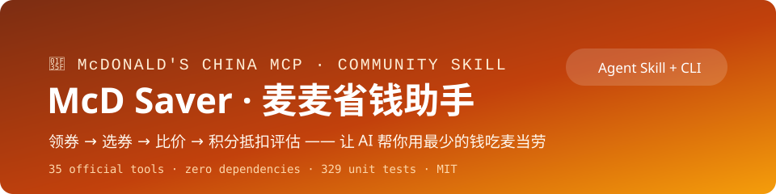
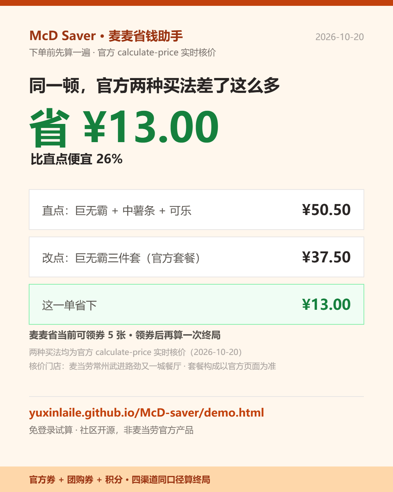

<div align="center">

# 🍟 McD Saver



**让 AI 帮你用最少的钱吃麦当劳** —— Agent Skill + 独立 CLI 二合一

[](https://yuxinlaile.github.io/McD-saver/demo.html)
[](https://github.com/yuxinlaile/McD-saver/releases/tag/v2.2.1)
[](https://github.com/yuxinlaile/McD-saver/actions/workflows/ci.yml)

-green)


**[🎮 30 秒在线试算（免登录）](https://yuxinlaile.github.io/McD-saver/demo.html) · [📦 快速开始](#快速开始) · [💬 讨论区](https://github.com/yuxinlaile/McD-saver/discussions) · [🛍️ Also on Agensi](https://www.agensi.io/creators/creator-571) · [English](README_EN.md)**



</div>

---

## 目录

- [项目简介](#项目简介)
- [功能特性](#功能特性)
- [快速开始](#快速开始)
  - [30 秒体验（免 Token）](#30-秒体验免-token)
  - [安装步骤](#安装步骤)
- [使用说明](#使用说明)
  - [命令速查](#命令速查)
  - [全渠道比价示例](#全渠道比价示例)
- [配置说明](#配置说明)
- [项目结构](#项目结构)
- [工具能力总览](#工具能力总览)
- [常见问题](#常见问题)
- [更新说明](#更新说明)
- [发布产物与版本策略](#发布产物与版本策略)
- [反馈与支持](#反馈与支持)
- [参与贡献](#参与贡献)
- [免责声明](#免责声明)
- [许可证](#许可证)
- [Star History](#star-history)

## 项目简介

麦麦省钱助手是一个以「省钱」为唯一目标的麦当劳点餐助手：**不是帮你下单，
而是在下单前强制跑一遍省钱检查**——把可领的券领完、挑出当前订单最优券、
用官方 `calculate-price` 做无券/带券双价对比、评估积分兑换是否更划算，
最后把省钱明细（原价 / 优惠 / 实付 / 节省比例）一并展示给你确认。

一个仓库，三种用法：

- **Agent Skill**：一份 `SKILL.md` 遵循开放标准，装进 WorkBuddy / Claude Code / Cursor / Codex 即用；
- **独立 CLI**：`scripts/mcd.py` 直连官方 MCP Server（[M-China/mcd-mcp-server](https://github.com/M-China/mcd-mcp-server) 集成指南），无需任何客户端；
- **在线试算页**：纯前端免登录，支持一键导入真实菜单。

**设计原则**——本项目在同类工具普遍做法的基础上做了这些取舍：

| 常见做法 | 本项目的做法 | 带来的差别 |
|---|---|---|
| 只对比官方券 | **官方券 + 美团/抖音团购 + 积分** 全渠道同口径估算「终局建议」 | 团购 App 里囤着的券也纳入决策 |
| 鼓励凑单用券 | 凑单以「不凑单」为基准，主动提示**凑单陷阱** | 为用券而多买常常反而更贵 |
| 券是可用资源 | 券是**有保质期的钱**：用券排程算出「可实现 vs 注定过期」 | 名义 ¥150 的券包，可能只有 ¥60 用得上 |
| 无面值券靠估算 | 券码 + couponId 传 calculate-price **实测**，失败如实标注 | 模型给不出真实价格，只能猜 |
| 营养靠口算 | 预算/热量/蛋白/钠**四维约束**，数据缺失按不满足处理并标注 | 健身控卡人群的硬需求 |
| 定时轮询领券 | `claim` 一次性交互确认，**不含自动化与定时任务** | 降低风控与封号风险 |
| 菜单靠手抄 | 在线试算页**一键导入真实菜单**（粘贴 MCP 输出即全量替换） | 官方菜单全量同步的合规路径 |

> **设计内核：把官方 App、美团、抖音、积分商城四个渠道放在同一张桌子上
> 算终局，而不是只在单一渠道内找局部最优。**

**订单安全**：用户明确确认前绝不创建订单；创建订单 ≠ 支付成功，
支付始终在麦当劳官方页面完成。

## 功能特性

**💰 省钱四步检查**（核心方法论，Agent 自动执行）

- 领券前置 → 门店选券 → 无券/带券双价对比 → 积分抵扣评估
- 每一笔优惠金额必须来自官方工具实际返回值，**绝不虚构**

**🧮 券组合优化器**（`optimizer.py`）

- 确定性枚举「无券直点 / 单券 / 凑单达标 / 改点套餐」候选，逐方案计价排名
- 四维约束：`--budget` 预算 / `--max-kcal` 热量 / `--min-protein` 蛋白 / `--max-sodium` 钠
- 违规方案排后并标注差多少，数据缺失如实标注「未知」——**绝不静默过滤**

**📉 全渠道比价引擎**（`deal_compare.py`）

- 美团/抖音团购券手动录入（平台无公开 API，不做爬虫），与官方价格同口径折算对比
- 输出「官方 vs 团购」终局建议，叠加规则与限制原样提示

**🩺 沉默成本体检**（`silent_cost.py`）

- 临期券扫描 + **用券排程**（过期窗口 × 点单频率 →「可实现 vs 注定过期」）
- 消费画像（客单价/高频单品）+ 积分影子价格
- 无面值券 `--probe` 实测精确价值；`--html` 生成可分享单文件报告

**📸 一键分享卡**（在线试算页）

- 试算完成后点相机按钮，直接导出 1080×1350 的「省钱账单」图（无第三方依赖，Canvas 绘制）
- 图内含无券价、最优方案、实付与省下金额，发群里比截图更清楚

**🛡️ 安全与合规设计**

- Token 三通道解析（环境变量/文件/参数），绝不写入日志
- 401 快速失败、429 指数退避尊重 `Retry-After`、5xx/网络错误自动重试
- 范围边界：聚焦下单前的省钱决策——不包含爬虫、自动下单、无人值守定时领券等自动化能力

**🧪 测试保障**：265 个单元测试覆盖 SSE 解析、Token 解析、退避计算、比价决策、
组合优化与 CLI 退出码；`demo.py` 全链路输出被 `tests/test_demo_pipeline.py`
断言——**demo 即回归测试**。

## 快速开始

### 30 秒体验（免 Token）

```bash
git clone https://github.com/yuxinlaile/McD-saver.git
cd McD-saver
python demo.py          # 离线全链路：领券→选券→比价→积分→排程→跨渠道
```

或直接打开[在线试算页](https://yuxinlaile.github.io/McD-saver/demo.html)（免登录，
31 项菜单 / 9 张券 / 11 条团购示例；支持 **Token 快速导入**——桌面生成命令、
手机端 Agent 粘贴或 menu.json 文件导入，同步麦当劳 App 全量真实菜单）。

### 安装步骤

**第 1 步 · 申请 MCP Token**（方式一/二需要；30 秒体验与在线试算不需要）

1. 打开 <https://open.mcd.cn/mcp>，右上角【登录】（手机号验证，限中国大陆）
2. 【控制台】→【激活】→ 同意服务协议 → 复制 MCP Token

**第 2 步 · 按场景选一种方式**

| 方式 | 适合谁 | 怎么做 |
|---|---|---|
| **方式一 · MCP 客户端直连** | 用 WorkBuddy / Cursor / Claude Code 等客户端 | 把 [`config/mcp.example.json`](config/mcp.example.json) 中 `${MCD_MCP_TOKEN}` 换成真实 Token，粘贴到客户端 MCP 设置（位置见[配置说明](#配置说明)）并启用 `mcd-mcp` |
| **方式二 · Agent Skill 安装** | 想让 Agent 自动触发省钱检查 | `git clone https://github.com/yuxinlaile/McD-saver.git ~/.claude/skills/maimai-saver`（Cursor: `~/.cursor/skills/` · Codex: `~/.agents/skills/` · WorkBuddy: `~/.workbuddy/skills/`，Windows 可直接运行仓库内 `install.ps1`），另按方式一配置 MCP 连接；各平台细节见 [agent-skill-installation.md](references/agent-skill-installation.md) |
| **方式三 · CLI 独立使用** | 脚本与调试，不装任何客户端 | `export MCD_MCP_TOKEN="你的Token"`（或写入 `~/.mcd_mcp_token` 文件），然后 `python scripts/mcd.py check` 验证连通性 |

安装 Skill 后 Agent 会按 `SKILL.md` 自动执行四步检查，并遵守四条规范：
**先查后改 / 下单必确认 / 省钱必检查 / 不虚构优惠**。

## 使用说明

### 命令速查

| 命令 | 作用 |
|---|---|
| `python demo.py` | **30 秒离线全链路演示**（免 Token；`--section 比价` 看单段） |
| `python scripts/mcd.py check` | 验证 Token 与服务器连通性 |
| `python scripts/mcd.py tools` | 列出全部 35 个官方工具 |
| `python scripts/mcd.py schema <tool>` | 查看指定工具的入参 JSON Schema |
| `python scripts/mcd.py call <tool> --arg k=v` | 调用官方工具（`--raw` 原始输出） |
| `python scripts/mcd.py claim` | 一键领取可领券（展示清单→确认→领取） |
| `python scripts/optimizer.py plan --wants w.json --menu m.json --coupons c.json [--mcp]` | 券组合优化；`--budget/--max-kcal/--min-protein/--max-sodium` 四维约束；本地券库非空时自动输出团购终局建议（`--no-deals` 关闭） |
| `python scripts/deal_compare.py add/list/compare` | 团购券录入与全渠道比价 |
| `python scripts/silent_cost.py report --coupons c.json --orders o.json --points p.json` | 沉默成本体检；`--probe` 实测券价值 / `--html` 生成分享报告 |

**CLI 退出码**（mcd.py）：`0` 成功 · `1` 工具错误 · `2` 鉴权失败 · `3` 限流 · `4` 网络错误
（deal_compare.py：`0` 成功 · `1` 用法/数据错误 · `2` 券库为空）

**全局选项**：`--token`、`--url`、`--timeout`（默认 30s）、`--retries`（默认 3）、`--verbose`。

> **claim 的安全边界**：用户主动触发、单次执行、领取前必须 y 确认（`--yes` 仅供
> 脚本）；不提供定时轮询与无人值守后台，以符合平台风控要求。

### 全渠道比价示例

```bash
# 录入你在美团查到的团购券
python scripts/deal_compare.py add \
    --platform meituan --title "麦当劳满40减14代金券" \
    --price 25.9 --face 40 --channel store --time limited \
    --valid-until 2026-11-30 --notes "每日限用1张"

# 与官方渠道（原价 48.5 / 带券实付 38.5）同口径对比
python scripts/deal_compare.py compare --mcd-face 48.5 --mcd-price 38.5
```

> 比价结果为本地估算（团购平台无公开 API），方法论见
> [group-buy-comparison.md](references/group-buy-comparison.md)；数据层预留
> `MAIMAI_DEALS_PROVIDER` 插件接口。

## 配置说明

**配置文件**

| 文件 | 用途 |
|---|---|
| `config/mcp.example.json` | MCP 客户端接入模板（`${MCD_MCP_TOKEN}` 占位符） |
| `mcp-config.example.json` | 仓库根目录脱敏配置（参赛要求文件） |

**环境变量**

| 变量 | 说明 |
|---|---|
| `MCD_MCP_TOKEN` | MCP Token（优先级最高） |
| `MCD_MCP_TOKEN_FILE` | Token 文件路径，默认 `~/.mcd_mcp_token` |
| `MCD_MCP_URL` | MCP Server 地址，默认 `https://mcp.mcd.cn` |
| `MAIMAI_DEALS_FILE` | 团购券库路径，默认 `~/.maimai_saver/deals.json` |
| `MAIMAI_DEALS_PROVIDER` | 外部数据源模块路径（需实现 `load_deals()`），可选；**该 .py 文件会被本机执行**，仅在你完全信任时设置 |

**MCP 客户端配置位置**：WorkBuddy `~/.workbuddy/mcp.json` · Cursor 设置 → Tools & MCP ·
Cherry Studio / Trae / VSCode / Kiro 各自 MCP 设置页 · Codex `~/.codex/config.toml` 的
`[mcp_servers.mcd-mcp]` 段。

**Token 安全**：仅通过环境变量、Token 文件或 `--token` 参数提供；绝不写入仓库文件、
绝不出现在日志中；泄露后立即到 open.mcd.cn/mcp 重新申请。

## 项目结构

```
scripts/     核心实现：MCP 客户端、CLI、券组合优化器、沉默成本体检、版本与发布工具
references/  方法论手册：工具目录、省钱策略、团购比价、场景工作流、MCP 踩坑、排错
docs/        在线试算页与品牌资源（demo.html / index.html / banner.svg）
tests/       265 项单元测试 + 规范一致性校验
fixtures/    离线回归数据（菜单、券、订单、积分、商城、团购）
releases/    发布产物：每版英文压缩包 + 中文说明 + 索引
```

完整文件级目录树见 [`SKILL.md`](SKILL.md#目录结构)。

## 工具能力总览

| 业务域 | 工具 |
|---|---|
| 营养健康 | `list-nutrition-foods` |
| 地址与门店 | `delivery-query-addresses` `delivery-create-address` `delivery-query-stores` `query-nearby-stores` `query-meal-assistance` |
| 菜单与价格 | `query-meals` `query-meal-detail` `calculate-price` `query-promotions` |
| 点餐与订单 | `create-order` `cancel-order` `query-order` `order-list` `query-survey-coupon` |
| 优惠券 | `query-store-coupons` `available-coupons` `auto-bind-coupons` `query-my-coupons` |
| 积分与商城 | `query-my-account` `mall-points-products` `mall-product-detail` `mall-create-order` `mall-order-list` `mall-order-detail` |
| 积分抽奖 | `query-lottery-info` `draw-lottery` `query-my-prizes` |
| 主题活动 | `query-party-city` `query-party-store` `query-partystore-date` `query-partystore-session` `party-order-create` |
| 辅助 | `now-time-info` `campaign-calendar` |

完整说明见 [`references/tools.md`](references/tools.md)；工作流详解见
[`references/workflows.md`](references/workflows.md) 与 [`SKILL.md`](SKILL.md)；
接入实战踩坑（响应格式/单位/多态字段/时效性）见
[`references/mcp-pitfalls.md`](references/mcp-pitfalls.md)。

## 常见问题

**Q1：401 鉴权失败？** Token 无效/过期/未提供。401 不重试，检查三个通道后到
[open.mcd.cn/mcp](https://open.mcd.cn/mcp) 重新申请。

**Q2：429 限流？** 每 Token 每分钟 600 次。CLI 已内置指数退避（尊重 Retry-After）；
仍失败请降低频率，检查是否在循环逐个调用 `query-meal-detail`。

**Q3：`tools` 列表为空？** 先 `check` 验证连通性；确认 `--url` / `MCD_MCP_URL` 未改错。

**Q4：工具报参数错误？** 不要猜参数名：`python scripts/mcd.py schema <tool>` 查权威入参；
编码类参数（storeCode、餐品编码、couponId）必须原样透传前序工具返回值。

**Q5：optimizer 估算模式和 `--mcp` 有什么区别？** 估算模式本地计算、标注「未经验证」，
仅用于快速比较；`--mcp` 模式逐方案走官方 calculate-price（含配送费与叠加规则），
结果才能作为下单依据。

**Q6：比价数据从哪来？** 美团/抖音无公开 API，券信息手动录入本地券库，结果为估算；
外部数据源可经 `MAIMAI_DEALS_PROVIDER` 接入。

**Q7：支持哪些 Agent？** WorkBuddy、Claude Code、Cursor、OpenAI Codex（同一 SKILL.md）。

**Q8：麦当劳 MCP 的使用限制？** 限中国大陆（不含港澳台）、个人非商业用途，
详见下方免责声明。

更多排查见 [`references/error-handling.md`](references/error-handling.md)（提 Issue 请勿附 Token）。

## 更新说明

当前版本 **v2.2.1**。近期版本要点：

| 版本 | 亮点 |
|---|---|
| **v2.2.0** | 测试 171→245 · 覆盖率 76% · 文档一致性进 CI · JSON-RPC 错误码修复 |
| **v2.1.3** | 滑杆支持直接输入数值 · 移动端卡片裁切修复 |
| **v2.1.2** | 试算页四维约束滑杆 · 真实运行验证记录 · CI 覆盖率门槛 |
| **v2.1.1** | 真实计价两阶段优化（Top-K 预筛，调用次数 -60%）|
| **v2.1.0** | 主动滑动窗口限速（300/min）· 方案排名场景标签 |
| **v2.0.3** | optimizer 自动衔接团购终局建议（官方 vs 团购一次算清）|
| v2.0.2 | 移动端文案适配 + 悬浮计算按钮（结果可达性）|
| v2.0.0 | 版本号自动递增工具（自定义 z.x.y 格式：y≤3、x≤6）|
| v1.7.4 | 试算页移动端优化（触控 44px / iOS 输入缩放规避）|
| v1.7.3 | 试算页 Token 快速导入卡片置顶 · 团购示例扩充 11 条 |
| v1.7.2 | 用券排程升级净价值模型（修正高估）· 客单价口径修正 |
| v1.7.1 | 省钱等级（S/A/B/C/D）· 参数自动串联技巧 |
| v1.7.0 | 点餐替换建议（热量代价从小到大）· 口味记忆 · MCP 实战踩坑指南 |
| v1.6.0 | 用券排程 · 券面值实测 · 可分享 HTML 体检报告 · 离线全链路 demo |
| v1.5.0 | 营养约束：蛋白质下限 / 钠上限，违规如实标注 |
| v1.4.x | 多维约束 + 套餐替换 + 积分影子价格 + 一键领券 |


完整变更记录见 [CHANGELOG.md](CHANGELOG.md)，各版本下载见
[Releases](https://github.com/yuxinlaile/McD-saver/releases)。

## 发布产物与版本策略

每个版本在 [`releases/`](releases/README.md) 与同名 GitHub Release 上各有一对产物，命名固定：

| 类型 | 命名 | 形式 | 内容 |
|---|---|---|---|
| 英文名 | `mcd-saver-v<版本>.zip` | 压缩包 | 对应 tag 的完整源码，解压后根目录 `McD-Saver-v<版本>/` |
| 中文名 | `麦麦省钱助手-v<版本>-发布说明.md` | 说明文档 | 版本信息、安装指引、该版变更记录、SHA-256 校验 |

- 版本号遵循项目自定义 `z.x.y` 规则（修订号 ≤3、次版本号 ≤6，超限进位），由 `scripts/version.py` 递增并同步发布文件
- 产物由 `scripts/build_releases.py` 生成与校验：`--all` 构建全部版本、`--verify` 校验命名、配对与压缩包完整性
- 每个 tag 与同名 Release 一一对应，Release 挂载同名压缩包与说明文档，形成「tag ↔ Release ↔ releases 目录」三方一致
  （GitHub 资产名不支持非 ASCII：中文说明在 Release 附件中另存为 `mcd-saver-v<版本>-release-notes-zh.md`，
  内容一致，**中文原名以 `releases/` 目录为准**）

## 反馈与支持

如有问题或建议，欢迎在 [讨论区留言](https://github.com/yuxinlaile/McD-saver/discussions)，
或按场景选择：🐛 [提交 Bug 报告](https://github.com/yuxinlaile/McD-saver/issues/new?template=bug_report.md) ·
💡 [提出功能建议](https://github.com/yuxinlaile/McD-saver/issues/new?template=feature_request.md) ·
🤝 [分享团购券数据](https://github.com/yuxinlaile/McD-saver/discussions)（助力比价库更全）。
每一条反馈都会认真查看——这也是试算页持续按真实使用场景优化的依据。

## 参与贡献

欢迎 Issue / PR / Discussions：工作流文档、中英校对、工具目录更新（以 `tools`
子命令实时结果为准）。完整流程见 [CONTRIBUTING.md](CONTRIBUTING.md)；
真实运行留档见 [examples/verified-run.md](examples/verified-run.md)；离线算例见 [examples/three-ways.md](examples/three-ways.md)（一单三种买法）与 [examples/silent-cost-example.md](examples/silent-cost-example.md)（沉默成本体检读法）。

提交前确认：pytest 全过 · 无 Token 等敏感信息 · `references/` 与 `SKILL.md` 同步 ·
CHANGELOG 补充 · **README 中英同步**。

## 免责声明

本项目为**社区开源项目，与麦当劳公司及其关联方无任何隶属、合作或背书关系**。
使用麦当劳 MCP 服务须遵守麦当劳中国《使用条款》及《麦当劳 MCP 服务规则》，
仅限**中国大陆地区（不含港澳台）**、**个人非商业用途**；省钱明细来自官方工具
实际返回值，不构成价格承诺。"McDonald's"、"麦当劳"、"麦乐送"、"麦麦"等商标
权利归属麦当劳公司。

## 许可证

本项目代码以 [MIT](LICENSE) 许可证发布；运行依赖麦当劳中国 MCP 服务及上游
集成指南仓库（[M-China/mcd-mcp-server](https://github.com/M-China/mcd-mcp-server)），
相关使用须遵守其服务条款与上游限制。

## Star History

觉得有用的话，点个 ⭐ 让更多人看到：

<div align="center">

[](https://star-history.com/#yuxinlaile/McD-saver&Date)

</div>

---

<details><summary>🔍 搜索关键词</summary>
<br>

麦当劳省钱 优惠券管理 团购比价 美团抖音券 积分价值 Agent Skill MCP CLI 组合优化 净价值 沉默成本 营养约束 免登录试算 麦麦省钱助手 McD Saver 麦门 精算师 · McDonald's China, coupon optimizer, deal comparison, group-buy, points valuation, nutrition budget, silent cost audit, MCP agent skill, Claude, WorkBuddy, Cursor, Codex, online calculator

</details>
